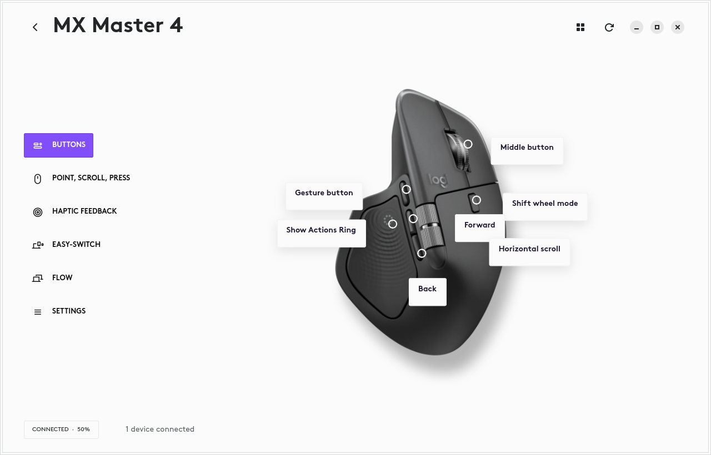

# Options for Linux

**Your Logitech mouse. More at home on Linux.**

A native Linux app bringing familiar Options+ controls to your desktop—starting
with the MX Master 4. Adjust how your mouse feels, tune its scrolling, and explore
haptic feedback from one place.



*The native GTK app in our development setup. This screenshot uses locally
extracted Logitech artwork and fonts; the public checkout uses fallback visuals
without those assets.*

## Make your mouse feel right

- **Pointer speed:** adjust your mouse’s DPI.
- **Scrolling:** control wheel mode and SmartShift, plus vertical and thumb-wheel direction.
- **Buttons:** inspect and change supported button mappings.
- **Haptics:** adjust vibration strength and feel a preview.
- **Keyboard:** choose F1–F12 or media keys, and adjust MX Keys for Business backlighting.
- **Tray access:** reopen settings, see both batteries, and check background service status from the top bar.
- **Remembered settings:** applied changes are saved and restored by the background service.
- **Device status:** see your connected devices and battery levels.
- **Actions Ring:** an experimental GNOME extension for shortcuts at your thumb,
  with a background listener that starts at login—even with the app closed.
- **Per-app rings:** choose eight actions for each app, with an All apps fallback.

## Built from real devices

This project began with an MX Master 4, a Linux desktop, and a Mac running the
original Options+ app. Its controls are built from observed application behavior,
reverse engineering, and direct device communication.

Mouse controls and haptic intensity have been tested on an MX Master 4 over Bolt.
MX Keys for Business also supports battery readings, function-key mode, and backlight controls. The Actions Ring
works in the tested GNOME desktop session, including after a restart.

## Try the early build

**This is a working experiment, not yet a complete Options+ replacement.**
Broader device profiles, Flow, macros, keyboard customization, and full Actions Ring parity are
still unfinished.

### Install on Ubuntu

**Requires Ubuntu 26.04 (amd64) with GNOME 50.** The package includes the tray,
background service, GNOME extension, and device-access rules. Solaar is not required.

Add our signed APT repository once, then install:

```bash
curl -fsSLo /tmp/logioptions-linux-keyring.gpg https://enriquemorenotent.github.io/logioptions-linux/apt/logioptions-linux-archive-keyring.gpg
sudo install -m 644 /tmp/logioptions-linux-keyring.gpg /usr/share/keyrings/logioptions-linux-archive-keyring.gpg
curl -fsSLo /tmp/logioptions-linux.sources https://enriquemorenotent.github.io/logioptions-linux/apt/logioptions-linux.sources
sudo install -m 644 /tmp/logioptions-linux.sources /etc/apt/sources.list.d/logioptions-linux.sources
sudo apt update
sudo apt install logioptions-linux
```

Open **Options for Linux** from the app launcher. **Log out of Ubuntu and back in**
after first-time setup to load Actions Ring. The tray and background service then
start at login; you can close the settings window and keep using the ring.

Updates arrive through Ubuntu’s normal package updates. To update manually:

```bash
sudo apt update
sudo apt install --only-upgrade logioptions-linux
```

Prefer a direct download? Get the `.deb` from
[GitHub Releases](https://github.com/enriquemorenotent/logioptions-linux/releases),
open a terminal in its download folder, and run:

```bash
sudo apt install ./logioptions-linux_0.1.0_all.deb
```

Use the filename of the version you downloaded. Installing the `.deb` alone does
not add the update repository; use the APT setup above for future updates.

**[Setup and development guide →](docs/DEVELOPMENT.md)**

## Help shape what comes next

Have a Logitech device you’d like supported, or a feature you miss on Linux?
[Open an issue](https://github.com/enriquemorenotent/logioptions-linux/issues)
with your device model, Linux distribution, and what you’d like to do.

Curious about the implementation? Explore the [research notes](research/EVIDENCE.md)
and [feature coverage](research/COVERAGE.md).

---

Independent project. Not affiliated with or endorsed by Logitech. Official
installers, extracted asset files, and private hardware captures are not bundled.
