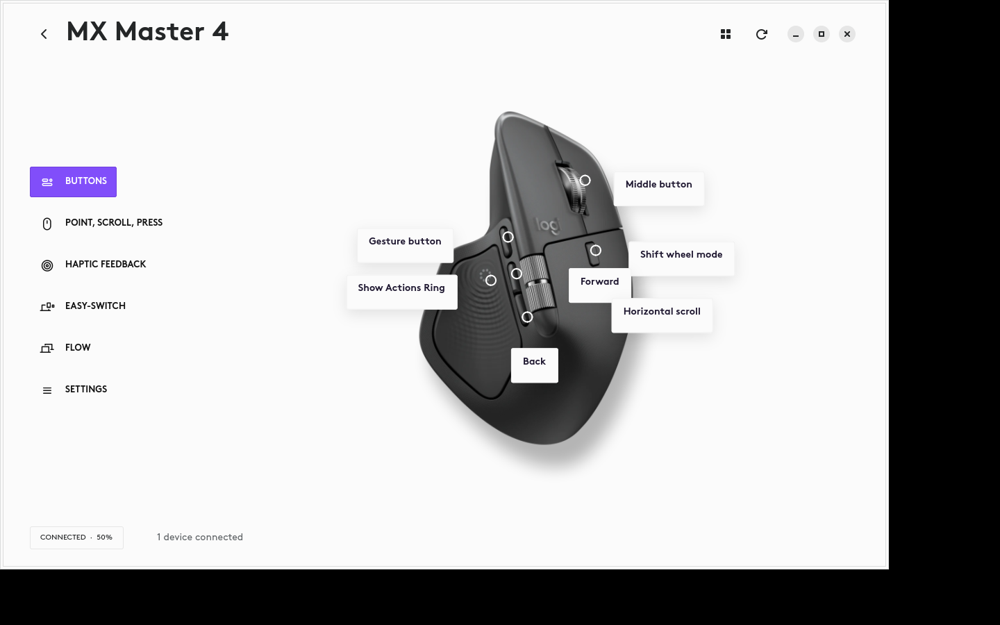

# Options for Linux

**Your Logitech mouse. More at home on Linux.**

A native Linux app bringing familiar Options+ controls to your desktop—starting
with the MX Master 4. Adjust how your mouse feels, tune its scrolling, and explore
haptic feedback from one place.

*The native GTK app in our development setup. This screenshot uses locally
extracted Logitech artwork and fonts; the public checkout uses fallback visuals
without those assets.*

## Make your mouse feel right

- **Pointer speed:** adjust your mouse’s DPI.
- **Scrolling:** control wheel mode and SmartShift.
- **Buttons:** inspect and change supported button mappings.
- **Haptics:** adjust vibration strength and feel a preview.
- **Device status:** see your connected devices and battery levels.
- **Actions Ring:** an experimental GNOME extension for shortcuts at your thumb.

## Built from real devices

This project began with an MX Master 4, a Linux desktop, and a Mac running the
original Options+ app. Its controls are built from observed application behavior,
reverse engineering, and direct device communication.

Mouse controls and haptic intensity have been tested on an MX Master 4 over Bolt.
MX Keys for Business discovery and battery readings also work. The Actions Ring
has passed isolated desktop checks; testing it in the everyday desktop session
is still pending.

## Try the early build

**This is a working experiment, not yet a complete Options+ replacement.**
Profiles, Flow, macros, keyboard customization, and full Actions Ring parity are
still unfinished.

Development currently targets Ubuntu 26.04, with GNOME 50 for the Actions Ring.
There’s no packaged installer yet; running from source requires Python, GTK 4,
libadwaita, and access to your device’s HID interface.

**[Setup and development guide →](docs/DEVELOPMENT.md)**

## Help shape what comes next

Have a Logitech device you’d like supported, or a feature you miss on Linux?
[Open an issue](https://github.com/enriquemorenotent/logioptions-linux/issues)
with your device model, Linux distribution, and what you’d like to do.

Curious about the implementation? Explore the [research notes](research/EVIDENCE.md)
and [feature coverage](research/COVERAGE.md).

---

Independent project. Not affiliated with or endorsed by Logitech. Official
installers, extracted asset files, and private hardware captures are not bundled.
